I build tools for the repetitive parts of everyday work.

Interested in **web development, document processing, and automation**.

### My approach

Start with a real task. Make a small tool. Improve it through use.

### Tools I work with

### GitHub activity

Public activity · updated daily. Private work is not included in this card.
